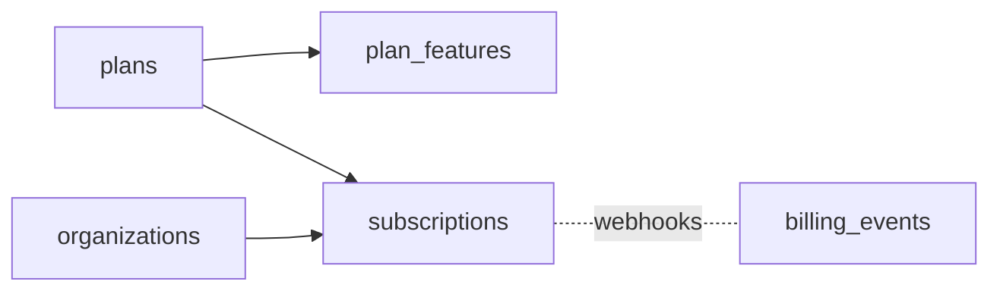

| Table | Contains | Used by |
| --- | --- | --- |
| plans | The four plans: `key` (`free`, `menu`, `restaurant`, `business`), `price_minor`, currency USD, `interval` (month), `per_branch`, `is_public`, `sort_order`. | billing, admin |
| plan_features | Per plan, the feature keys it includes (such as `pos.access`) and numeric limits (such as `limit.products` = 40) in `limit_value`. A missing limit row means unlimited. | billing, admin |
| subscriptions | One row per restaurant (unique `org_id`): plan, `status` (`trialing`, `active`, `past_due`, `canceled`), `branch_quantity`, Paddle ids, `trial_ends_at`, `current_period_end`, `canceled_at`, `scheduled_change`, `provider_event_at`. A null `provider` means a complimentary plan. | billing, identity (session entitlements), admin |
| billing_events | Raw Paddle webhooks: unique `provider_event_id`, type, payload, `processed_at`, `error`. Stored first, then applied, so a failed delivery can be retried. | billing |

## How it fits together

- The plan a restaurant actually gets is **computed** from its subscription row and the current time, not stored. A trial that has passed `trial_ends_at` resolves to Free, and a canceled subscription keeps its plan until `current_period_end`.
- `provider_event_at` rejects out-of-order webhooks.
- Only the API writes these tables. The billing page reads them through the billing module.

See [Trial and billing](/subscriptions/billing) for the owner-facing behavior.
