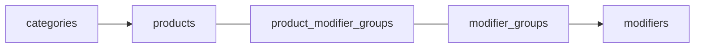

All catalog tables are tenant scoped, use soft delete (`deleted_at`) and store names as `jsonb` keyed by locale, for example `{"en": "Burger", "ar": "برجر"}`.

## Tables

| Table | Contains | Used by |
| --- | --- | --- |
| categories | Menu sections: translated name, `sort_order`, `is_active`, `available_in_all_branches`. | catalog (owner and manager menu editing), public-menu |
| products | Items for sale: category, translated name and description, `price_minor`, `image_key`, `is_active`, `available_in_all_branches`, `sort_order`. | catalog, public-menu, and ordering (price lookup at order time) |
| product_branches | Join table: the branches that show a product when `available_in_all_branches` is false. | catalog, public-menu, ordering |
| category_branches | Join table: the branches that show a category when `available_in_all_branches` is false. | catalog, public-menu |
| modifier_groups | A choice set such as "Size": `min_select`, `max_select`. | catalog, public-menu |
| modifiers | One option in a group, such as "Large", with `price_delta_minor`. | catalog, public-menu, ordering |
| product_modifier_groups | Join table: which groups apply to which product, with `sort_order`. | catalog, public-menu |

## Notes

- A product belongs to exactly one category, enforced by a composite key on `(category_id, org_id)`.
- Products and categories are shared across the restaurant, but each can be limited to some branches. `available_in_all_branches` is true by default, so new branches show the item automatically. When it is false, the item is shown only in the branches listed in `product_branches` or `category_branches`. A product appears in a branch only if both the product and its category are available there.
- Deleting a product or modifier only sets `deleted_at`. Past orders keep their [name and price snapshots](/database/ordering).
- The plan limit `limit.products` counts products here. See [Plans and pricing](/subscriptions/plans).
