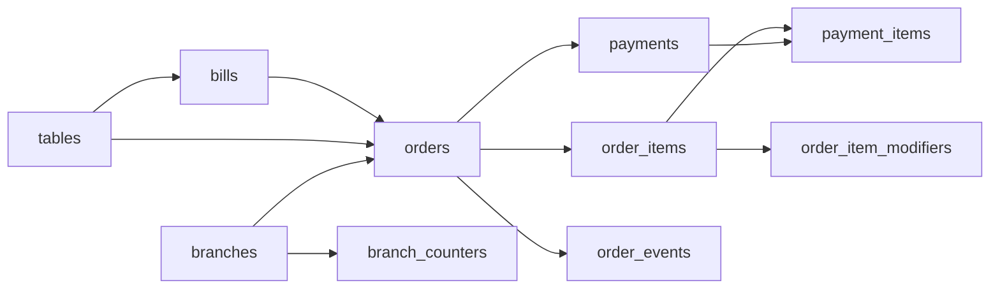

## Tables

### tables
Dining tables per branch: `label`, a unique `qr_token` for the table QR code, `is_active`. Unique by `(branch_id, label)`.
**Used by:** ordering.

### branch_counters
One row per branch per business date holding `last_order_number`, so order numbers restart each day without gaps.
**Used by:** ordering, when an order is placed.

### orders

The order header. Key columns: `type` (`dine_in`, `takeaway`), `status` (`draft`, `placed`, `preparing`, `ready`, `completed`, `cancelled`, `refunded`; a manager or owner can reopen `completed` to `ready` with the `orders.reopen` permission, logged as an event with `reopen: true`), `payment_status` (`unpaid`, `partial`, `paid`, `refunded`), `table_id`, `bill_id` (nullable; takeaway orders have none), `pager_number`, `customer_name`, `notes`, `subtotal_minor`, `discount_minor`, `tax_minor`, `total_minor`, `currency`, `cancel_reason`, `version` (optimistic locking), `business_date`, `order_number`, and the timestamps `placed_at`, `completed_at`, `cancelled_at`. `client_order_id` makes creation safe to retry from the POS. **Used by:** ordering, kitchen display, reporting (daily sales), realtime, admin overview counts.

### order_items

Lines on an order: `product_id`, `product_name_snapshot`, `unit_price_minor`, `quantity`, `line_total_minor`, `notes`, `status` (`pending`, `preparing`, `ready`, `voided`), `is_addition` (added after the first send), `seat` (guest label for splitting the bill), and void details. **Used by:** ordering.

### order_item_modifiers
Chosen modifiers for a line, with `name_snapshot` and `price_delta_minor` copied at order time.
**Used by:** ordering.

### payments
Money taken for an order: `method` (`cash`, `card`, `other`), `amount_minor`, `tendered_minor`, `change_minor`, `status` (`captured`, `refunded`), `created_by` (membership). Amount must be positive. `client_payment_id` makes payment retries safe.
**Used by:** ordering and reporting (payment breakdown).

### bills

One open tab per table visit. Groups the dine-in orders (rounds) of a table: `table_id`, `status` (open or closed), opened and closed timestamps. A settled bill closes automatically when a new order arrives at the table. Creating the first bill of a table is guarded by a per-table lock, so two devices cannot open duplicates. **Used by:** ordering, the POS Tables page.

### payment_items

Links a captured payment to the order items it paid, so a bill can be paid by guest or item in several steps and no item is paid twice. **Used by:** ordering.

### order_events

Append-only history of an order: event `type`, `from_status`, `to_status`, `payload`, `actor_membership_id`, and `approved_by_membership_id` when a manager or owner approved a cashier's cancel or void with their PIN. Includes `order.table_moved` when an order is moved to another table. **Used by:** ordering (order timeline and the audit of approvals).

## Notes

- Totals and names are **copied** onto the order, so editing the menu or a tax rate later never changes past orders.
- Child rows use `ON DELETE RESTRICT`, so an order with history cannot be removed by deleting its branch or table.
