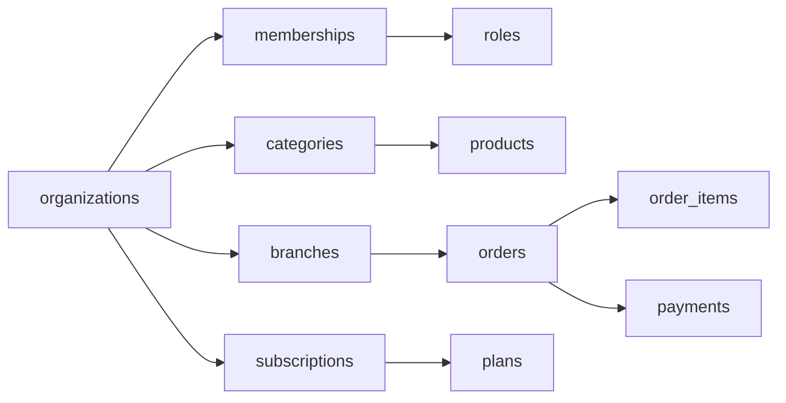

Sahtain uses one Postgres database, defined with Drizzle in `apps/api/src/core/db/schema` and migrated from `apps/api/drizzle`. It has **28 tables** in five areas.

## The five areas

| Area | Tables | Used by (API module) |
| --- | --- | --- |
| [Tenancy and identity](/database/tenancy-identity) | organizations, branches, roles, role_permissions, memberships, membership_branches, users, auth_sessions | tenancy, identity |
| [Catalog](/database/catalog) | categories, products, modifier_groups, modifiers, product_modifier_groups | catalog, public-menu |
| [Ordering](/database/ordering) | tables, branch_counters, orders, order_items, order_item_modifiers, payments, order_events | ordering, kitchen, reporting |
| [Billing](/database/billing) | plans, plan_features, subscriptions, billing_events | billing |
| [Platform admin and infra](/database/admin-infra) | admin_users, admin_sessions, audit_logs, outbox_events | admin, core/outbox |

Open [Comparing similar tables](/database/comparisons) to see which tables look alike and why they are kept apart.

## Rules every table follows

- **Tenant scoping.** Almost every business table has an `org_id`. Row level security (RLS) is enabled and forced on them, so a request only sees its own restaurant's rows. The tables without RLS are the global ones: `users`, `auth_sessions`, `plans`, `plan_features`, `billing_events` and the platform admin tables.
- **Composite foreign keys.** Child tables reference their parent by `(id, org_id)`, so a row can never point at a parent in another restaurant.
- **Money** is stored as integer minor units (`*_minor`, bigint), never decimals. The currency is stored beside it.
- **Translated text** (category, product, modifier names, descriptions) is stored as `jsonb` keyed by locale.
- **Soft delete.** Catalog tables use `deleted_at` so old orders keep working.
- **Snapshots.** Orders copy product and modifier names and prices at order time, so later menu edits never change history.
- **Ids** are client-safe UUIDs, and timestamps are `timestamptz`.

<Note>
  Run migrations and the `app_admin` role setup from `infra/postgres/init/01-roles.sql` before starting the API on a new machine. The admin tables are only reachable by the `app_admin` database role.
</Note>
